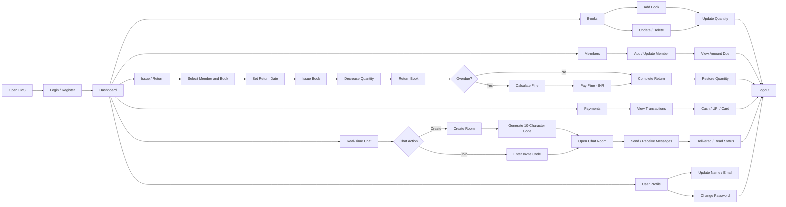

# Library Management and Real-Time Communication System

A Django-based Library Management System for managing books, members, borrowing records, payments, user profiles and real-time chat.

## Project Overview

The system digitizes common library operations and provides librarians with a centralized dashboard. It supports:

- Book inventory management
- Member management
- Book issue and return processing
- Overdue and fine tracking
- INR payments
- Custom librarian accounts and profiles
- Real-time direct and group chat
- Django Admin management

## Technology Stack

| Area | Technology |
|---|---|
| Backend | Python, Django |
| Database | SQLite for local development, PostgreSQL support |
| ORM | Django ORM |
| Authentication | Django Authentication |
| Real-Time Chat | Django Channels, WebSockets |
| Production Channel Layer | Redis / Upstash Redis |
| Local Channel Layer | In-memory Django channel layer |
| Frontend | HTML, CSS, JavaScript, Django Templates |

## Project Structure

```text
lms/
├── core/                # Project settings and main URL configuration
├── users/               # Librarian authentication and profile
├── library/             # Books, members, lending and payments
├── chat/                # Rooms, messages and WebSocket consumer
├── templates/           # Django HTML templates
├── static/              # CSS, JavaScript and theme assets
├── staticfiles/         # Collected production static files
├── db.sqlite3           # Local SQLite database
├── manage.py            # Django command-line entry point
└── requirements.txt     # Python dependencies
```

## User Flow



## Main Features

### Dashboard

The dashboard provides:

- Total member count
- Total book count
- Number of borrowed books
- Number of overdue books
- Recently added books
- Total collected amount
- Overdue amount

### Books

Librarians can add, edit, delete and search books. Every book contains title, author, category, quantity, borrowing fee and availability status.

### Members

Members can be created, searched, updated or removed. The system shows each member's outstanding overdue amount.

### Lending and Returns

The system creates borrowing records, updates inventory quantity and calculates fine payments. On return:

1. The due date is checked.
2. If overdue, a fine payment is required.
3. The transaction is recorded.
4. The borrowed book is marked returned.
5. The book quantity is restored.

### Indian Rupee Payments

All monetary values are represented in Indian Rupees:

- Display currency: ₹
- Supported payment methods: Cash, UPI and Card
- Values use Django Decimal fields with two decimal places

### User Profile

Logged-in users can update:

- First name
- Last name
- Email address
- Password

The profile also shows account role and registration date.

### Real-Time Chat

The chat module provides:

- Direct 1-to-1 rooms
- Group rooms
- Room owner, admin and member roles
- 10-character invite codes
- WebSocket message delivery
- Delivered and read receipts
- Message pagination
- Automatic reconnect after connection loss

## Database and ORM

Database tables are represented by Django models.

### Library Models

- `Member`
- `Book`
- `BorrowedBook`
- `Transaction`

### User Model

- `Librarian`

The custom librarian model uses email as the login field.

### Chat Models

- `ChatRoom`
- `RoomMember`
- `Message`
- `MessageReaction`
- `ReadReceipt`

Django ORM replaces raw SQL for most application operations. For example:

```python
Book.objects.all()
Member.objects.filter(name__icontains=query)
BorrowedBook.objects.filter(returned=False)
```

## CSRF Protection

Django CSRF middleware protects POST forms and state-changing requests. Django forms include:

```html

```

## Django Migrations

Model changes are converted into migration files and applied to the database.

```powershell
python manage.py makemigrations
python manage.py migrate
python manage.py showmigrations
```

Migration folders are maintained inside the `users`, `library` and `chat` apps.

## Setup Instructions

### 1. Create and Activate a Virtual Environment

```powershell
cd C:\ca2\lms
py -m venv venv
.\venv\Scripts\Activate.ps1
```

### 2. Install Dependencies

```powershell
python -m pip install --upgrade pip
python -m pip install -r requirements.txt
```

### 3. Configure the Environment

```powershell
Copy-Item .env.example .env
```

Set `SECRET_KEY` and `DEBUG` in `.env`. If no database URL or PostgreSQL variables are configured, the project uses `db.sqlite3`.

### 4. Prepare the Database

```powershell
python manage.py makemigrations
python manage.py migrate
```

### 5. Create a Super Admin

```powershell
python manage.py createsuperuser
```

### 6. Start the Development Server

```powershell
python manage.py runserver
```

Open:

- Application: `http://127.0.0.1:8000/`
- Django Admin: `http://127.0.0.1:8000/admin/`
- Login: `http://127.0.0.1:8000/login/`
- Profile: `http://127.0.0.1:8000/profile/`
- Chat: `http://127.0.0.1:8000/chat/`

## Test Commands

```powershell
python manage.py check
python manage.py test
python manage.py test library
python manage.py test users
python manage.py test chat
```

## Security Features

- Password hashing
- Django login authentication
- Login-required views
- CSRF protection
- Email uniqueness
- Super Admin and staff roles
- Server-side chat membership verification
- Invite code expiry and room capacity validation
- HTML escaping for chat content

## Future Improvements

- Barcode or QR-based books
- Automatic fine calculation
- Email notifications
- Payment gateway integration
- Mobile application
- Attachment and voice message upload
- User presence indicators
- Typing indicators
- Cloud deployment
- Reports and analytics dashboard
